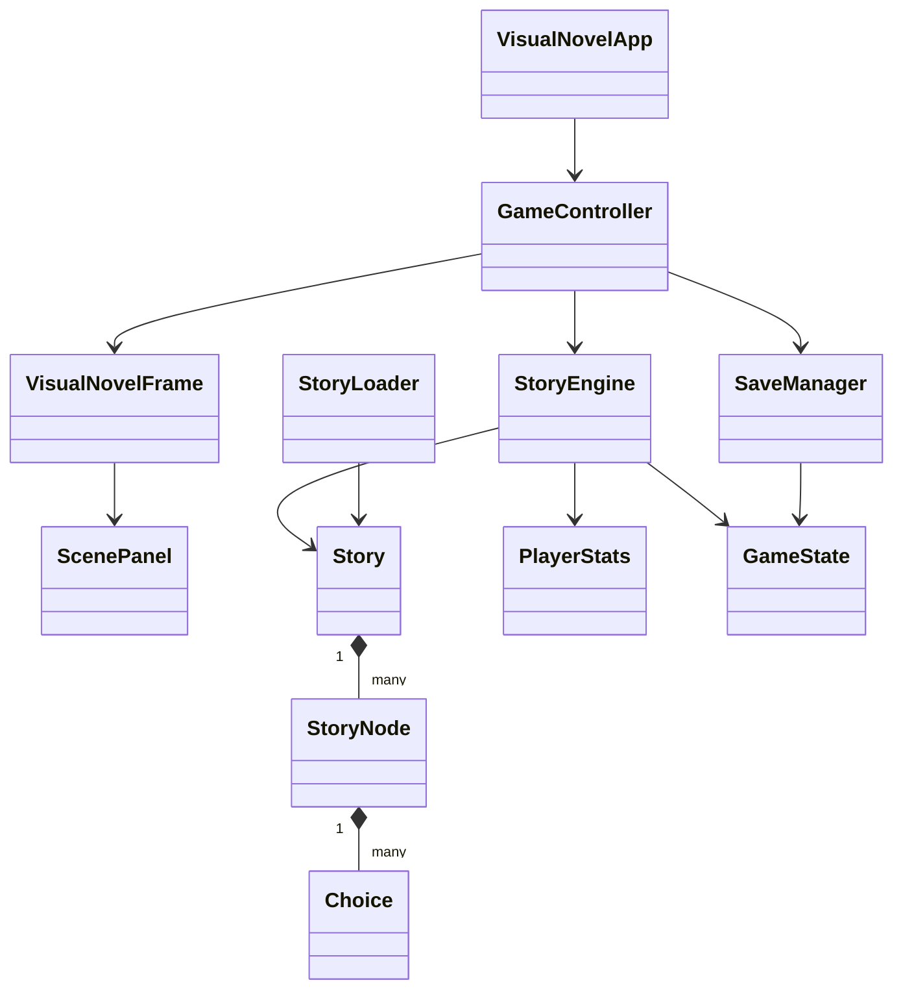

# Design — Presentation Edition

## Responsibilities and methods

| Package / class | Responsibility and key methods |
|---|---|
| app.VisualNovelApp | main(): loads story and connects MVC on Swing's event thread |
| controller.GameController | startNewGame(), choose(), advance(), autoSave(), refresh(), saveGame(), loadGame() |
| model.StoryEngine | Owns one session; canChoose(), choose(), advance(), evaluateEnding(), snapshot(), restore() |
| model.Story | Validates references; getNode() and getNodes() expose an immutable graph |
| model.StoryNode | Immutable scene content, choices, continuation, location, speaker, chapter |
| model.Choice | Label, destination, effects, requirements; isAvailable() |
| model.PlayerStats | changeStat(), applyChanges(), reset(), snapshot(), restore(), toDisplayString() |
| model.GameState | Immutable current scene, absolute stats, and ordered history |
| text.StoryLoader | load(): parses external UTF-8 records and validates the graph |
| persistence.SaveManager | exists(), save(), load(), getTimestamp(): versioned campaign-specific persistence |
| view.VisualNovelFrame | JPanel-based view; showWindow() hosts it in a JFrame; render(), registerActions(), selectSlot(), confirm(), showHistory() |
| media.ScenePanel | setScene(), paintComponent(): scalable illustrated backgrounds and expressive portraits |

The model has no GUI or file dependencies. The controller delegates game rules to the engine and storage to SaveManager. The view renders snapshots and reports actions through callbacks. The view is a reusable panel, with showWindow() supplying its desktop host; this allows the actual interface to be tested and rendered without a display server.

Choices validate requirements and destination before committing stats and history. Restore validates the node and a complete stat snapshot before replacing the session. Continue scenes are explicit transitions; they do not apply stat changes. Save failures report errors without discarding the running game. Scene/choice data uses lists and maps; an optimized ADT is unnecessary for this scale.

## Class relationships

## CRC cards

| Class | Responsibilities | Collaborators |
|---|---|---|
| StoryEngine | Own session, enforce options, evaluate endings, capture/restore history | Story, PlayerStats, GameState |
| Story | Validate graph and resolve IDs | StoryNode, Choice |
| StoryNode | Describe narrative, metadata, options, and continuation | Choice |
| Choice | Describe effects and minimum availability | Stat snapshot |
| PlayerStats | Own four stats; apply deltas and absolute restoration | StoryEngine |
| GameState | Carry immutable state between components | StoryEngine, SaveManager |
| StoryLoader | Parse external story and reject malformed records | Story, StoryNode, Choice |
| SaveManager | Persist campaign snapshots and timestamps | GameState |
| GameController | Coordinate global actions, autosave, confirmations, and refresh | StoryEngine, SaveManager, VisualNovelFrame |
| VisualNovelFrame | Display state, collect actions, manage reading preferences and ending collection | Controller callbacks, ScenePanel |
| ScenePanel | Paint locations, portraits, expressions, and ending confetti | VisualNovelFrame |
| VisualNovelApp | Load story and start the desktop host | StoryLoader, GameController |

## Course-report mapping

| November 2 task | Implementation |
|---|---|
| Connect main program to StoryEngine, StoryNode, Choice, PlayerStats | VisualNovelApp creates services; GameController delegates actions |
| Branches, requirements, and effects | 8 decisions, 24 response branches; Choice.isAvailable() and engine validation |
| Scenes with no choice | Explicit Continue destinations and StoryEngine.advance() |
| Exam and endings | One exam decision followed by five-rule ending evaluation |
| GUI and menu | Chapter/speaker labels, portraits, stat meters, menu/resume, journal |
| Save/load and timestamp | Three manual slots plus autosave; full state and local display of UTC save time |
| Test paths, stats, and restoration | Reproducible route simulations, ending boundaries, graph checks, full-view render tests |
| README, Javadocs, UML, CRC | Included source docs, this design, guide, and test report |
| Graphics enhancement | Original classroom, library/lab, cafe, park, and night-room art; Maya, Leo, Chen, player portraits |

## Changes from the short version

Starting Energy is 4. Passing requires Knowledge 8, Confidence 4, and Energy 1. These thresholds balance the shorter eight-decision campaign. Strong support, exceptional preparation, or exhaustion select additional endings. The engine documents the exact precedence in STORY_GUIDE.md.

Story IDs and save balancing have changed enough that automatic migration would be unreliable. Save format 3 carries a campaign ID and rejects earlier saves explicitly. Existing files are not deleted. Java Preferences stores font size, reveal setting, and discovered ending IDs; these are local application preferences rather than transferable campaign state.

Chapters use a branching-response structure. Each action gets different dialogue and consequences, then rejoins the next decision. Requirements offer alternate approaches at selected points. The story does not claim to contain 41 scenes per playthrough or 41 independent routes. A legal playthrough visits 21 scenes and reaches one ending.

## Limits

There is no user-authored save migration, timeline rewind, audio, or animated character system. Character differences are stylized variations in original Java2D illustrations. Stat totals are signed integers rather than hidden normalized percentages; meters show a reference range while the label displays the exact value. The pass/fail outcome is a narrative model, not a real academic-grade calculation. No team member work hours or contribution claims have been fabricated.
